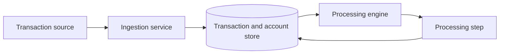

# Transaction Processor

## Overview

This service accepts account transactions that may arrive more than once or out of order. It records each transaction idempotently and reserves per-account sequence slots so execution preserves the required order. Processing applies accepted credits and debits atomically with a ledger entry while preventing negative balances.

## Tech stack

- Java 17
- Spring Boot 4.1.1, Spring MVC, Spring Data JPA, Hibernate, and Jakarta Validation
- H2 in-memory database
- Maven wrapper
- JUnit 5, Mockito, and AssertJ

Application classes use the `com.assessment.transaction_processor` base package, organized into `config`, `dto`, `entity`, `enums`, `repository`, `service`, `source`, and `validator` packages.

## How to run and test

Run the application with `./mvnw spring-boot:run` (on Windows, use `mvnw.cmd spring-boot:run`). Run the test suite with `./mvnw clean test` (on Windows, use `mvnw.cmd clean test`).

## Assumptions

1. Sequence numbers are scoped to each account.
2. A duplicate is any later request with the same `transactionId`, regardless of payload.
3. The cursor continues after a failed transaction.
4. A pending transaction that exceeds the pending timeout becomes `FAILED`.
5. The retry delay is configurable.
6. The balance can never be negative.
7. Only `CREDIT` and `DEBIT` transaction types are supported.
8. A single currency per account is assumed.

## Status lifecycle

| Status | Meaning | Associated reason |
|---|---|---|
| `PENDING` | Accepted but not yet executed | `AWAITING_SEQUENCE` or `AWAITING_RETRY` |
| `PROCESSING` | Execution is in progress | None |
| `PROCESSED` | Execution completed successfully | None |
| `FAILED` | Terminal failure | A `FailureReason` |
| `DUPLICATE` | A repeated transaction identifier | Logged separately; the original is unchanged |

## Data model summary

| Entity | Purpose |
|---|---|
| `Account` | Current balance, per-account next expected sequence, and optimistic version |
| `TransactionRecord` | The original request, status, lifecycle fields, and its unique account sequence slot |
| `DuplicateRequestLog` | Each repeated transaction identifier and whether its payload matched |
| `RejectedRecord` | Malformed, stale, or conflicting requests that cannot own a sequence slot |
| `LedgerEntry` | The immutable balance effect of each successfully processed transaction, unique by transaction id |

## Architecture

Sources provide raw requests to ingestion, which validates idempotency and stores sequence-slot records. The engine drains affected accounts; each processing step locks an account, decides the current cursor slot, then atomically updates the balance, ledger, transaction, and cursor.

## Ordering Strategy

Transactions are buffered by per-account sequence number rather than arrival time. Because balances cannot become negative, execution order can change whether a debit is valid: a debit arriving ahead of its funding credit would fail if arrival order were used.

The cursor starts at 1. The sequence gate processes a pending eligible transaction at the cursor, blocks when the slot is absent or awaiting a future retry, and advances past terminal `FAILED` or `PROCESSED` records. It never skips an empty sequence gap. The engine repeats steps until the next slot blocks, with each step committed independently.

For account `ACC-201`, suppose sequence 2 is a `DEBIT` of 40 and sequence 1 is a `CREDIT` of 100. If sequence 2 arrives first, it remains `PENDING/AWAITING_SEQUENCE`; the cursor does not skip sequence 1. Once sequence 1 arrives, the drain credits the balance to 100, advances the cursor, then debits 40 and records a balance of 60. Both transactions are processed in sequence order even though they arrived in reverse order.

## Concurrency

Each processing step takes a pessimistic write lock on its account row before reading the cursor or current sequence slot. That serializes competing drains for one account while allowing different accounts to progress independently. The account's optimistic `@Version` remains a second defence against updates that bypass the row-locking processing path.

## Progress log

- Step 1: Added the Maven/Spring Boot 4 foundation, configuration and clock, entities and repositories, input validation and transaction sources, idempotent ingestion, and focused tests under `com.assessment.transaction_processor`.
- Step 2: Added the sequence gate, account-locked atomic processing step, unique ledger entries, per-account drain engine, post-commit batch draining, and H2/unit/concurrency coverage. Retries, fault injection, schedulers, reports, and REST endpoints remain out of scope.
