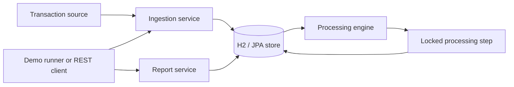

# Transaction Processor

## Start here

A Java 17 / Spring Boot service that ingests duplicate and out-of-order account transactions, processes each account in sequence, and maintains a transaction ledger without allowing negative balances.

Run the tests with `./mvnw test`. To run the demonstration, use `./mvnw spring-boot:run -Dspring-boot.run.profiles=demo` (on Windows, use `mvnw.cmd`). The demonstration reads [`src/main/resources/sample/transactions.json`](src/main/resources/sample/transactions.json), waits for retries and sequence timeouts, prints a report, and writes JSON to `output/processing-report.json`. The captured text report is in [`docs/sample-output.txt`](docs/sample-output.txt).

## DESIGN NOTE

### Architecture

The source and REST controller supply raw records to the ingestion service. Ingestion validates and persists idempotency, rejected requests, and sequence slots. The processing engine drains accounts through short, separately committed processing steps. Reports aggregate stored transactions, rejected requests, duplicate logs, account balances, and ledger entries.

### Idempotency design

`transactionId` is the idempotency key. A first accepted transaction owns its transaction ID and, where applicable, its `(accountId, sequenceNumber)` slot. Later requests with the same ID are written to `duplicate_request_log`; their payload is compared for reporting only, and the original transaction is not updated.

### Duplicate detection logic

Ingestion checks `transactions.transaction_id` before evaluating a slot. If no existing record is found, persistence remains protected by primary/unique constraints. A transaction-ID collision detected at commit is re-read and logged as a duplicate. A distinct transaction ID attempting an occupied account sequence is instead recorded as `SEQUENCE_CONFLICT`.

### Out-of-order handling strategy and trade-offs

Sequences are account-scoped. An early transaction is stored as `PENDING/AWAITING_SEQUENCE`; the cursor never auto-skips an absent slot. Once a missing sequence is stored, the engine processes successive eligible slots and skips terminal records such as validation failures and timeouts.

Sequence order is necessary because the non-negative-balance rule makes outcomes order-sensitive. For example, account `ACC-201` receives sequence 2 (`DEBIT 40`) before sequence 1 (`CREDIT 100`). Sequence 2 waits; after sequence 1 is accepted, the credit executes first and the debit succeeds, leaving 60. The trade-off is head-of-line blocking: a gap or delayed retry holds up later transactions for that account, but does not block other accounts.

### Retry and failure handling

Processing writes the balance, ledger entry, status, and cursor in one database transaction. Configured fault injection runs after the balance and ledger writes but before commit; on an exception the whole processing transaction rolls back. The engine records the attempt in a separate transaction, schedules `nextAttemptAt`, and stops draining that account until the retry is due. Attempts are persisted, and reaching the configured total-attempt limit records `RETRIES_EXHAUSTED` and advances the cursor.

Pending sequence records older than the configured timeout become `FAILED/SEQUENCE_TIMEOUT` in their original slot. They are not removed or used to auto-skip a missing earlier sequence.

### Observability approach

Structured SLF4J events include transaction/request IDs, a masked account identifier, status, and attempt number. Amounts, raw payloads, and full account identifiers are excluded. The report is available as JSON through `GET /api/report`, as a rendered text table in the demo, and as JSON in `output/processing-report.json`.

The report includes lifecycle counts (including rejected records in the failed totals), pending and failure reasons, duplicate count, retry counts, per-account balances/cursors/pending ages/gaps, rejected safe messages, and a ledger-to-balance integrity check.

### Data consistency and concurrency

One processing step is one database transaction. It locks the account row pessimistically before re-reading the cursor and slot, then updates the account, ledger, and transaction atomically. The account `@Version` field supplies an additional optimistic check; the ledger transaction ID is unique as a final duplicate-effect guard. Concurrent processing of different accounts can proceed independently.

### Security and data handling

Input fields are validated before a record can execute. API errors return only a safe code and message, without exception details or stack traces. Event logging masks account IDs and avoids amounts and payloads. The current report and account/transaction read endpoints are intended for this assessment; production access controls and stricter identifier/PII policies are still needed.

### Known limitations

- H2 is in-memory, so state is lost when the application stops.
- Retry delay is fixed rather than exponential, and fault injection is a demonstration feature.
- Scheduling is local to one application instance; multi-instance coordination is not implemented.
- Empty sequence gaps deliberately remain blocked until a record arrives; the system has no operator action to resolve a permanently missing sequence.
- Report aggregation currently reads repository data into memory and is intended for the assessment-sized data set.
- The API does not yet include authentication or authorization.

### Production hardening recommendations

- Replace the in-memory database with a persistent database and manage schema changes with Flyway.
- Use an outbox pattern for reliable integration with downstream systems.
- Introduce a real queue partitioned by `accountId`.
- Use `SKIP LOCKED` or ShedLock for multi-instance scheduling.
- Add a dead-letter queue for exhausted or repeatedly failing transactions.
- Add Micrometer metrics and alerts for sequence gaps and retry exhaustion.
- Provide an operator API to void or explicitly skip a sequence.
- Use exponential backoff with jitter.
- Define an idempotency-record retention policy.
- Add authentication, authorization, and appropriate PII controls.

## Progress log

- Step 1: Added the Spring Boot/Maven foundation, H2/JPA entities and repositories, validation, file/in-memory sources, idempotent ingestion, and tests.
- Step 2: Added account-locked atomic processing, sequence ordering, ledger entries, per-account draining, and concurrency coverage.
- Step 3: Added configurable fault injection, persisted retries, pending timeout and stuck-processing recovery jobs, and deterministic resilience tests.
- Step 4: Added processing reports, structured safe event logging, demo runner and sample scenario, REST read/ingestion endpoints with safe errors, and report/API/end-to-end coverage.
